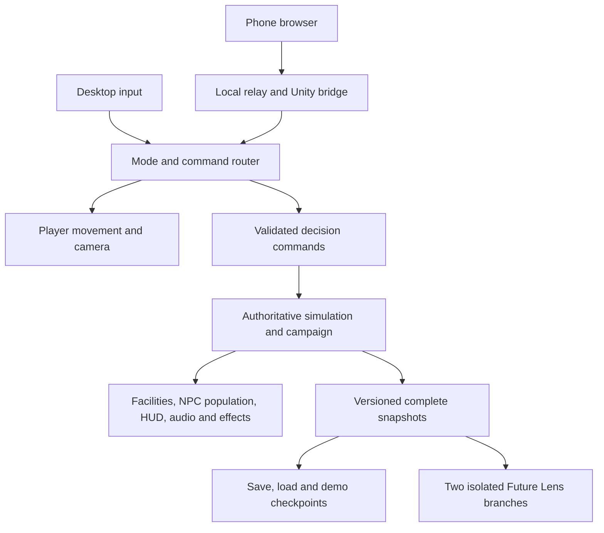

# Campus Pulse 2030 — final game implementation plan

Date: 13 October 2026 (Asia/Calcutta). Deliverable: implementation plan following a repository audit. **Production is incomplete.** No new gameplay was implemented for this plan.

## 1. Final experience

**Play a student campus coordinator on foot. Meet students, discover visible problems, direct repairs and see the whole campus respond. Switch to an overhead view to allocate resources and compare outcomes.**

User-confirmed priorities:

- Real third-person field view with a visible, animated, human-size player.
- A few clearly visible students walking around the player, with readable bodies, faces, clothing and movement.
- Overhead management remains a second view of the same session.
- First-person is optional and comes only after the required experience passes acceptance.

The central loop is **notice → walk → inspect → choose → act → observe → adapt**. Walking gives context to the decisions; overhead view reveals their wider consequences. The distinctive demonstration is a judge controlling this same live campus from a phone, then seeing a reproducible Future Lens comparison of their decisions.

Success is measured by playability and evidence. No promise of outperforming other teams is justified from a plan.

## 2. What the audit actually found

Read: master specification, GAME_SPEC, original implementation plan, AGENTS, progress, acceptance, Foundation–Phase 4 handoffs, simulation/runtime/controller source and existing test evidence. No Phase 5 handoff was present. Existing Phase 5 edits remain intact.

| Finding | Source | Required response |
|---|---|---|
| Latest saved EditMode XML has 22 passes; PlayMode XML has 7 failures | `Logs/Campus/*-results.xml`; reviewed summary in `docs/evidence/Phase6Planning/audit.json` | Reproduce after preserving scenes. Six failures are unexpected connection logs; one reports missing audio component. Do not assume seven independent gameplay defects or suppress all logs. |
| Editor poll exits Play Mode even with no command pending | `Editor/CampusAutomation.cs`, `Poll` | Highest priority: gate actions on an explicit request; never interrupt normal gameplay or tests automatically. Respect dirty scenes. |
| Students follow rectangles around buildings, with procedural limb swings | `Runtime/CampusLife.cs`, `LivingCampusBuilder.WalkerPrefab` | Keep the authoritative population model; replace nearby visual walkers with human-scale rigged students and actual footpath navigation. |
| No controllable on-foot player found | `Runtime/`, saved player systems | Add player and camera as a new presentation/input layer. Preserve existing strategic camera. |
| Save serializes selected scalar fields only | `CampusState.ToJson/LoadFromJson`, `CampusCampaign.ToJson/LoadFromJson`, `CampusSession.LoadGame` | Complete versioned snapshots; retain tickets, facilities, cooldowns, incidents, objectives, accumulators and state needed for deterministic continuation. |
| Future Lens compares live A against partial-state projected B; some labels are constants | `Runtime/FutureLensManager.cs` | Replace with two complete isolated branches and computed metrics/visuals at an identical horizon. Current cosmetic sunlight change is insufficient. |
| `DeepClone` does not carry campaign; fingerprint is only a partial aggregate | `Simulation/CampusState.cs` | Add complete campaign snapshot and canonical full-state comparison; present clone/fingerprint tests do not establish campaign forecast correctness. |
| Old `Input.GetKeyDown` is used while `activeInputHandler: 1` selects new Input System | `FutureLensManager.cs`, `ProjectSettings.asset` | Use the installed Input System consistently; verify in player. |
| Cinematic Update and strategic LateUpdate write the same virtual camera | `CampusCinematics.cs`, `StrategicCamera.cs` | Give camera control a single explicit owner. Current cutscene skip also only skips intro. |
| Phone catalog uses IDs such as `labs/admin/waste` instead of `research/administration/recycling`; several IDs are absent | `server/public/controller.js`, `LivingCampusBuilder.cs` | Send the real facility/action catalog from Unity, including actual costs and availability. Example: phone repair price is INR 20,000; simulation defines INR 2,200. |
| Chapter advancement has no completion guard; chapter replay omits state when setting chapter start | `CampusCampaign.AdvanceToNextChapter`, `CampusSession.PlayChapter` | Separate campaign progression from labeled demo navigation; fix clock and checkpoint restoration. |
| Crisis and ending history are incomplete | `CampaignModel.cs` | Old main-leak repair can immediately resolve a later rupture; expiry is counted as resolution; report adds three assumed resolved incidents. Model incident lifecycles and record real history. |
| Existing phone tests cover five narrow relay cases, not complete device/protocol behavior | `server/test-server.js` | Add independent QR decoding, schema/idempotency/lease tests and real-device walkthrough. |

All source paths above are under `Assets/_Game/` unless stated otherwise. These are source-review findings, not newly reproduced runtime failures. Current binary provenance is not established. Historical short performance captures do not certify the expanded game.

## 3. Ground-level scale and camera — mandatory quality bar

Do not solve the small-student appearance by enlarging distant characters disproportionately. Establish consistent scale, lower the camera and build the foreground for close inspection.

Initial tuning targets, to be adjusted in the actual courtyard:

| Element | Starting target |
|---|---|
| World scale | 1 Unity unit = 1 metre; audit existing buildings, doors, roads, props and collider scale before changing them |
| Player and student height | Approximately 1.65–1.85 m, feet at ground level, normal proportions |
| Player capsule | About 1.8 m height, 0.3 m radius; tune to actual model and paths |
| Follow camera | Roughly 3.5–5 m behind player, shoulder target around 1.4–1.6 m, 55–65° vertical FOV |
| Walking / running | Start around 2.5 / 4.5 m/s for player; students around 1.0–1.5 m/s; match clip speed to prevent sliding |
| Interaction | 2–3 m radius plus unobstructed line of sight; readable contextual prompt |
| First slice population | 6–8 students in one courtyard; visibly encounter 3–5 along the test route |
| Initial full-campus visual cap | Around 24 detailed active students, typically 4–8 nearby; reduce/tune from profiling, never inflate the simulation count |

At 1080p, target the player's visible body occupying roughly 25–40% of screen height during default traversal. Nearby students should be easy to distinguish at conversational distance. Capture actual screenshots beside a doorway, bench, canteen queue and leaking valve before approving scale. People will naturally appear smaller when the user deliberately zooms to a whole-campus view.

Third-person camera requirements: smooth mouse/touch look; pitch limits; collision avoidance behind walls and trees; consistent shoulder framing; no camera below the ground; instant reduced-motion transitions. Use the installed Cinemachine 3.1.7, with one output camera and explicit ownership among third-person, strategic, cinematic and Future Lens modes. Unity documents [Third Person Follow](https://docs.unity.cn/Packages/com.unity.cinemachine%403.1/manual/CinemachineThirdPersonFollow.html); installed package source remains the API authority.

## 4. Playable character and controls

Create one original or redistribution-cleared student coordinator with a consistent stylized-realistic appearance, backpack/ID and readable silhouette. Require idle, walk, run, turn, inspect/tablet and interaction clips. A capsule or the current primitive crowd figure is acceptable only during engineering, not final character acceptance.

Use `CharacterController` with explicit gravity, grounded movement, slopes/steps and obstruction handling. Animate from actual velocity; avoid simultaneously driving movement with root motion. Start without jumping, vehicles or combat. Add an unstuck action restoring a nearby valid waypoint without resetting campus state.

| Action | On-foot desktop | Overhead desktop | Phone target |
|---|---|---|---|
| Move | WASD | WASD pan | Left joystick moves player or pans according to active mode |
| Look | Mouse movement | Right-drag / Q/E orbit | Right thumb look area in field mode; orbit controls overhead |
| Run | Shift | Not applicable | Hold Run |
| Inspect/interact | E | Click facility | Context-sensitive Inspect/Interact |
| Change view | Tab | Tab | Explicit Field / Overview button |
| Focus | Context card / map marker | F | Focus selected facility |
| Pause/back | Esc | Esc | Pause/back button |
| Future Lens | L or tablet button | L or HUD button | Clearly labeled Lens button when available |

Controls are proposed, not implemented. Context prevents E from both interacting and orbiting. Opening a modal releases cursor lock, blocks world clicks and zeroes movement. Closing restores the previous input mode. Desktop activity takes priority over phone movement to prevent opposing blended axes.

Switching overhead parks the avatar at the same safe position and retains simulation, selection, budget and pending actions. Returning restores that position and camera direction. Clicking a distant building focuses the camera; it does not teleport the character. Demonstration checkpoint travel is separate and labeled.

## 5. A few believable students walking around campus

### Characters and animation

Use 2–3 compatible rigged base meshes with 4–6 clothing/backpack variations. Keep materials coherent and human proportions credible. Prefer project-authored assets or documented redistribution rights; do not assume a downloaded model/animation is free to ship. Retain existing `Student.prefab` and `.meta`; introduce `StudentNpc.prefab` and replace references deliberately after testing.

Students need idle, walk, turn and brief chat/queue animations. Look toward their route or a nearby speaker; avoid synchronized loops. No spoken dialogue is required for the core version. A brief student response should describe actual conditions, such as long waits or lost water service.

### Paths and behavior

Use the installed AI Navigation package with a baked campus walking surface. Author paths between academic entrances, canteen, library, hostel, garden and utility observation points. Keep walking lanes separate from service vehicle lanes. Bake only intended walkable surfaces; roof and decorative geometry must not create accidental routes.

State machine: `Idle → ChooseDestination → Walk → Arrive → Queue / Chat / Rest → ChooseDestination`. Add pause, blocked-route recovery and incident reaction states. Use `NavMeshAgent` for pathfinding/local avoidance and an Animator driven by actual motion. Students do not own resource counts.

- Give each active student a valid start and destination; check path completeness.
- Vary walking speed modestly and avoid two agents choosing the same queue slot.
- Establish spaced queue positions, release slots in order and reserve clear player access.
- Recover stalled agents by replanning; do not visibly teleport them through the player.
- Spawn/despawn out of view at entrances or occluded points. Do not replace nearby people during a mode switch.
- Use consistent pause behavior across simulation, player, NPCs, trucks and effects; UI continues working.
- Use simple non-blocking or gentle avoidance behavior around player so decorative crowds cannot trap them. Cosmetic agents must not block emergency interactions.

### Connection to resource gameplay

Authoritative zone occupancy/queue counts decide a bounded number of visible students. A visual is a representative sample, not one actual simulated student. A student walking between zones must not increment/decrement the population by itself. The coordinator is a staff/player role, outside the counted student population.

The existing crowd renderer can continue for distant strategic presentation during migration. Add `CampusPopulationPresenter` to choose one renderer per zone; disable old detailed walkers in zones handled by new NPCs. Never show both systems on top of each other.

When canteen waiting rises, occupy more available queue slots, use waiting gestures and show the actual wait estimate. Opening a counter increases authoritative service rate; the queue then shortens over time. Diversion moves the visible flow to the garden only after the simulation accepts the action. Scarcity/outages alter routes, poses or localized student comments according to state; animation does not award score.

### NPC acceptance

Walk the route with 6–8 students for five minutes: verify no wall crossing, hovering, visible respawn, long foot sliding, permanent traffic jam or empty intended gathering area. Pause/resume, reroute, open the counter and switch views ten times. Record close-up footage/screenshots and profiler samples. Increase the cap only after the slice passes.

## 6. Walkable campus and actual field interactions

Preserve the existing campus layout, stable IDs and generated assets. Audit close-up colliders: the current generator removes many primitive colliders and uses broad building colliders for selection. Separate selection bounds from physical collision. Large selection boxes must not block walkable porches; add deliberate walls, ground, steps and railings without blindly attaching colliders to every mesh.

First polish one short circuit: **courtyard → water valve → canteen → recycling point → courtyard**. Target 10–25 seconds of travel between its key interactions after measuring the scene. Extend routes to the remaining existing facilities once this loop is enjoyable. Avoid a large empty map or adding interiors everywhere.

| Place | What player sees and does | Authoritative effect and tradeoff |
|---|---|---|
| Water station | Sees/hears leak, inspects valve, chooses repair, conservation or temporary rationing; confirms work and watches intervention | Budget and staff reserved once; completion reduces real loss. Rationing affects satisfaction; boosted pumping adds power demand. |
| Research/academic electrical panel | Reads demand/idle lighting, requests load reschedule, LED retrofit or temporary shedding | Load and cumulative energy change; cost, delay and comfort tradeoffs remain visible. |
| Recycling point | Sees bin fill/overflow, requests collection or segregation improvement, watches pickup | Collection moves accounted mass; segregation changes recovery yield. One cosmetic pickup cannot delete untracked waste. |
| Canteen entrance | Sees students waiting, speaks to steward, opens counter or directs garden diversion | Queue/service/occupancy change; extra counter adds electricity and waste. |

Local interaction shows two or three meaningful choices with actual cost, staff, duration and projected consequence. A short hold-to-confirm/inspection animation may improve tactile feedback, but resource action acceptance/completion comes from the command/ticket lifecycle. Cancelled prompts cannot charge; repeated taps cannot complete twice. Crew-scale work remains a dispatched task even when the player is at the location.

Successful actions produce a visible state change, audio cue, ticket result and concise before/after readout. Avoid generic success messages when the command was rejected. Optional student conversations teach through the current problem; they are not a mandatory dialogue tree.

## 7. Requirements traceability

These map the user-supplied Save the Campus criteria to planned final acceptance. They are not a claim of independently checking the original competition PDF.

| Requirement | Visible problem | Meaningful action | Measured consequence / evidence |
|---|---|---|---|
| Excessive water consumption | Leak, falling reservoir, scarcity complaint | Repair, low-flow or ration | L/min and cumulative litres; before/after world state and ledger |
| Excessive electricity consumption | Lit idle block, deficit, pump stopped | LED, reschedule, shedding or backup | kW balance, kWh, fuel, service availability |
| Waste management | Full bins and overflow | Collection, segregation, capacity | kg conserved across bin/overflow/recycling/disposal |
| Overcrowding | Visible queue and wait estimate | Extra counter, stagger or divert | Queue length, wait time and conserved population |
| Inefficient resource usage | Idle loads and competing staff requests | Efficiency upgrade / timing change | Cost per benefit, reduced waste of capacity; compare equal scenarios |
| Resource allocation | Budget and crews insufficient for every simultaneous request | Prioritize and schedule jobs | Reservation/release ledger; rejected unaffordable action |
| Decision-making | At least two viable interventions with different drawbacks | Choose one strategy and observe | Action history links choice to measured outcome |
| Unexpected situations | Seeded burst, surge, heat or gathering | Reallocate resources and recover | Activation/expiry/resolution history; deterministic replay |
| Student satisfaction | Waiting, darkness, litter, water complaints | Balance services and conservation | Time-averaged satisfaction plus reason for change |
| Campus sustainability | Persistent loss, inefficient loads, disposal | Maintain efficient operation | Published cumulative score inputs; ending gates include all categories |

## 8. Architecture and integration contracts



Keep pure C# simulation free of scene references. Player position/camera are presentation state stored alongside the simulation snapshot. A foot interaction, overhead action and phone tap use the same action ID, target ID, request ID, validation and acknowledgment. Scene objects never assign budget or resource values.

Proposed additions under `Assets/_Game/Scripts/Runtime/`: `CampusPlayerController`, `CampusCameraDirector`, `CampusInputRouter`, `WorldInteractable`, `PlayerInteraction`, `StudentNpc`, `CampusPopulationPresenter`, `JuryDemoDirector`. Names are proposed; reuse existing responsibilities rather than duplicate them. Add authoring anchors/navigation data under `Assets/_Game/Data/` and deliberate player/NPC prefabs. Preserve Unity-generated `.meta` identity.

Snapshots must cover seed/RNG continuation, facility records, clocks, pending tickets, cooldowns, queues, flow accumulators, action IDs, campaign objectives/incidents/history and final report. Parse into a temporary validated snapshot before replacing live state; atomic save with backup, explicit schema/config version, invariant numeric formatting, corrupt-save error UI. Old scalar-only saves need either an honest migration with documented losses or a clear incompatible-save response; never claim exact restoration.

Future Lens captures once, runs A and B to the same horizon with matched external events, and preserves the live state. B lists accepted alternative actions, including rejected/deferred actions and actual budgets. Metrics and causal text are computed. Show the same geometry/camera using isolated presentation snapshots; start with A/B toggle, then add the required synchronized split/slider when profiling passes. Lighting alone cannot represent a projected future.

Campaign remains three clearly labeled days with a calendar/absolute tick distinct from time of day. Current code uses three same-day time windows; correct this or explicitly retain chapter terminology until the day requirement is implemented. Track real incident history across days. Normal progression cannot skip unmet gates; demo navigation uses separate complete snapshots. Test success, balanced recovery, costly recovery and failure through playable policies, not budget overrides alone.

## 9. Phone control in third person

Retain local Node HTTP/WebSocket service and browser controller with no paid/cloud dependency. Serve all assets locally. Unity remains authoritative. Retain keyboard/mouse fallback.

Before new movement messages, fix IDs/prices, catalog availability, pairing state and acknowledgment feedback. Authenticate the host separately, restrict host endpoints, enforce one active controller, validate finite bounded axes and message size/rates, and use sequenced idempotent discrete commands. Current host route and session API need access review; LAN presence alone should not permit replacing the host.

Add mode-aware `move`, `look`, `run`, `interact` and `change_view` contracts. A camera message must never accidentally move the player after a mode transition. Reset input on pointer-up/cancel, lost focus, hidden tab, pause, lease revocation and connection loss. Initial stale-movement target: stop within 250 ms of missing movement updates, even when heartbeats continue; measure it. Reconnect requests fresh state and discards old commands.

Real-device gate: launch Windows player → show fresh QR → scan → browser opens → accepted pairing → walk/look → select/inspect a facility → submit an intervention → verify actual resource change → disconnect while moving → character stops → reconnect with no duplicate action. Record phone model, OS/browser, network and results. Android and iPhone are separately unverified until each is tested; automated sockets cannot substitute.

Exact current launch instructions and limitations are in [RUN_GAME.md](RUN_GAME.md).

## 10. Implementation order and gates

Effort is an estimate for an experienced developer with reusable character assets, not an elapsed-time promise. Existing defects may change it. No parallel-agent work is required.

| Milestone | Deliverable and dependency | Exit gate | Estimate |
|---|---|---|---|
| 6A: Repair baseline | Preserve WIP; safe editor automation; scene wiring; consistent input/camera; meaningful test fixtures | Fresh compile and EditMode/PlayMode runs pass; ordinary Play Mode remains running; no discarded scene edits | 1–2 days |
| 6B: Repair truth and continuity | Full snapshots, campaign/crisis/scoring corrections, authoritative phone catalog and basic protocol fixes | Save in active job/crisis, load and compare future continuation; legitimate complete campaign; identical command from desktop/phone yields identical outcome | 2–4 days |
| 6C: Human-scale slice | Courtyard, rigged player, third-person camera, colliders, 6–8 walking students and water interaction | Five-minute on-foot route, close-up review, no clipping/stuck movement; overhead switch preserves all state | 2–3 days |
| 6D: Four-system field game | Expand interactions and NPC reactions, contextual HUD/tutorial, all facility routes | New player completes all four categories and entire campaign without developer intervention | 2–3 days |
| 6E: Connected demonstration | Phone movement/actions/reconnect, accurate Future Lens, cutscene ownership and audio/settings | Real Windows integration; complete forecast tests; device status recorded honestly | 2–3 days |
| 6F: Jury/release | Snapshot checkpoints, 15/5-minute modes, final art/performance, launcher, distribution and rehearsal | Acceptance matrix, clean profile/offline launch, complete build contents, release checksum and recorded full rehearsal | 2–3 days |

Planning range: approximately **11–18 focused developer-days**, plus asset production and 20–30% integration contingency if necessary. Re-estimate after 6C. If time is limited, reduce map coverage/presentation extras and postpone first-person; retain real field control, nearby students, all four systems, reliable desktop play and honest verification.

## 11. UI, visuals, audio and performance

Field HUD: compact resource strip, current objective, small map and interaction prompt. Details open only during inspection or in the campus tablet. Avoid keeping the current large side panels permanently over the character view. Show action availability, progress and cause/effect without obscuring walking paths.

Close-up art pass: feet/ground contact, door proportions, benches, bins, valves, signs, path edges, trees and building entrances. Add shadows and consistent materials before extra particle effects. Skin/clothing should hold up from normal follow-camera distance. Keep environmental audio spatial and alarms distinguishable; footsteps reflect walking/running. Provide independent audio controls, readable text, non-color-only warnings and reduced motion; captions for essential spoken content if introduced.

Implement explicit Low/Medium/High presets and window/resolution controls with persistence; verify real URP asset differences. Pool NPCs/effects; reduce distant animation updates and shadows. Do not spawn one visual per simulated student or evaluate a path every frame.

Performance targets, not measured results: 1080p on the user's laptop, median frame time ≤16.7 ms and p95 ≤22 ms in a five-minute representative run after warmup. Measure normal walking, busy canteen, crisis and Future Lens separately; capture CPU/GPU, quality, power mode, build type, resolution, NPC count and GC spikes. Previous 12-second overhead captures cannot prove these targets.

## 12. Jury mode and release acceptance

Create versioned checkpoints by replaying real legal decisions and saving full state: Arrival, Four Systems, Allocation, Crisis, Judge Control, Futures, Outcome. Restoring includes player position, camera, weather/presentation, authoritative state and UI. Clear held inputs and cancel stale effects; do not rotate a paired phone unnecessarily. Checkpoints show their demo label; they do not earn campaign achievements or invent a score.

Presenter controls: checkpoint list, next/back, pause, skip cinematic, speed control and reset demo. Returning to campaign restores its own save. An outcome checkpoint contains the genuine result of its recorded run; it must not be represented as the current judge's choices unless reached from those choices.

[DEMO_SCRIPT.md](DEMO_SCRIPT.md) gives the 15-minute and five-minute scripts, innovations and jury questions. Final package target:

```text
CampusPulse2030-Windows/
  CampusPulse2030.exe
  CampusPulse2030_Data/
  UnityPlayer.dll
  ...all other files produced by the chosen Windows build...
  Controller/server.js, lib/, public/
  Runtime/node.exe             (redistributable runtime with notices)
  Start-Game.cmd               (planned)
  Start-With-Controller.cmd    (planned)
  README.txt
  THIRD_PARTY_NOTICES.txt
  release-manifest.json        (version, source commit, hashes)
```

Use a tested offline Node runtime bundle for final distribution; verify its notices and avoid requiring a jury-time download. Current project uses installed Node. Launcher detects port conflicts, offers desktop-only play, checks relay readiness and shuts down only its own processes. Preserve the entire Unity build output; do not distribute only the EXE. Builds stay under `builds/`; attach the playable ZIP to a GitHub release, never commit binaries/caches/secrets.

Required checks: compile; simulation conservation; full campaign policies/endings; snapshot continuation/corruption/compatibility; camera/player/collider/interaction flows; NPC route/queue behavior; deterministic forecasts; controller schema/lease/reconnect; startup without Editor; graphics/audio/settings; clean Windows profile launch; private LAN without internet; five-minute performance runs; full jury rehearsal. Record exact commands, results and evidence in `TEST_REPORT.md` and `progress.md`.

No release-ready label until mandatory rows pass. Missing physical hardware remains **Blocked** for the device test, with implemented software separately labeled. Optional first-person does not block the agreed third-person + overhead release.

## 13. Exact first implementation action

Preserve the current worktree and explicitly save any intended open scene edits. Repair `CampusAutomation.Poll` first so it does nothing without a pending request and cannot terminate normal/test play. Inspect the active editor's scene before any generator command; do not regenerate the whole campus to fix a missing component.

After that repair, in Unity open **Window → General → Test Runner**, run EditMode `Campus.EditTests`, then PlayMode `Campus.PlayTests`, and save new results under `Logs/Phase6/`. The existing helper can also queue one operation at a time:

```powershell
powershell -NoProfile -ExecutionPolicy Bypass -File .\scripts\Invoke-CampusEditor.ps1 -Command edit-tests
# Wait for the actual completion record before the next request.
powershell -NoProfile -ExecutionPolicy Bypass -File .\scripts\Invoke-CampusEditor.ps1 -Command play-tests
```

The helper only queues commands; printing “Queued” is not a pass. Resolve failures and continuity defects before starting 6C. The first visual deliverable must be a playable courtyard with a full-size character and several clearly visible animated people, not another overhead screenshot.
